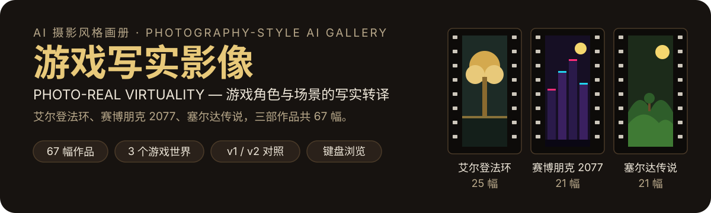
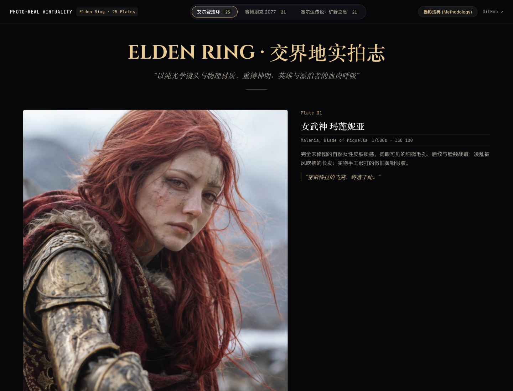
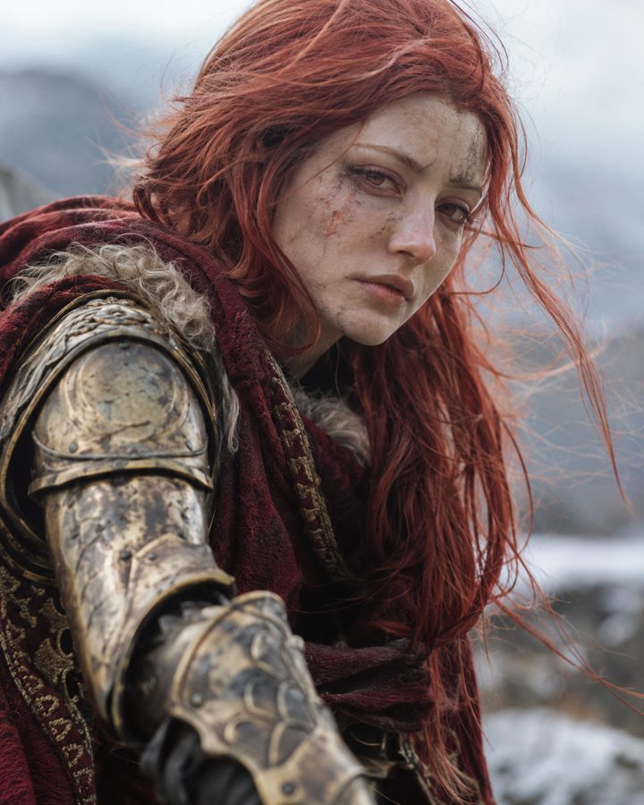

<p align="right"><a href="README.md">中文</a></p>

<p align="center">
  
</p>

<p align="center">
  <a href="https://elden-ring-liveaction.xiaosang.cc/">▶ View Online</a>
  ·
  <a href="https://github.com/holynova/elden-ring-liveaction">GitHub Repository</a>
</p>

PHOTO-REAL VIRTUALITY is a photography-style AI gallery reimagining Elden Ring, Cyberpunk 2077 and The Legend of Zelda as realistic photographs. 67 works in total, each with lens and shutter notes, a quote and a caption — browse them in the gallery or lightbox, with keyboard navigation.

## Screenshots

<p align="center">
  
  
</p>

## Three Worlds

| World | Works | Highlights |
|------|------|------|
| Elden Ring | 25 | Malenia, Melina, Leyndell, the Royal Capital; every work keeps a v1 original and a v2 photorealistic version for comparison |
| Cyberpunk 2077 | 21 | Judy, Johnny Silverhand, Panam, the Night City skyline |
| The Legend of Zelda: Breath of the Wild | 21 | Link, Zelda, travels across Hyrule |

## How to Browse

- **Switch worlds**: use the top selector, or press `G` to cycle through the three games.
- **View large**: click any image to open the lightbox, flip with `←` `→`, close with `Esc`.
- **v1 / v2 comparison**: every Elden Ring work keeps both its v1 original and its v2 photorealistic version, so you can compare the transformation side by side.
- **Lens notes**: each work is annotated with a lens (e.g. 85mm f/1.4) and shutter settings (e.g. 1/500s ISO 100) as style notes, not real shooting records.

## Run Locally

Zero build — just serve the static page locally:

```bash
python3 -m http.server 8080
# Open http://localhost:8080/
```

## Tech

- A single-page static site: one `index.html` holds the gallery, lightbox, and keyboard navigation — no framework, no build step.
- Work data lives in `games_data.py` (name, lens, shutter, quote, caption); `generate_full_index.py` generates the page data, and `generate_thumbnails.py` maintains the thumbnails.

```
index.html              Gallery single page: three-world switching, lightbox, keyboard navigation
games_data.py           Data for 67 works (name / lens / shutter / quote / caption)
generate_full_index.py  Generates the page from the data
generate_thumbnails.py  Thumbnail maintenance
originals/              Elden Ring v1 originals (25 works)
v2_20_gallery/          Elden Ring v2 photorealistic versions (20 works)
v2_realhuman/           Elden Ring v2 photorealistic versions (5 works)
cyberpunk/              Cyberpunk 2077 (21 works)
zelda/                  The Legend of Zelda (21 works)
```

## Disclaimer

All images are AI-generated unofficial fan works, not affiliated with FromSoftware, CD PROJEKT RED or Nintendo. Lens and camera parameters are style notes only.
