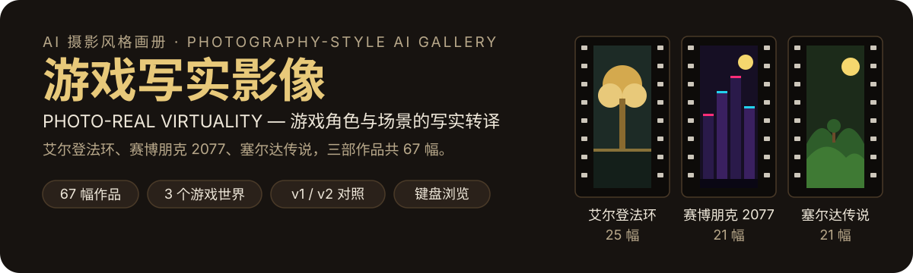
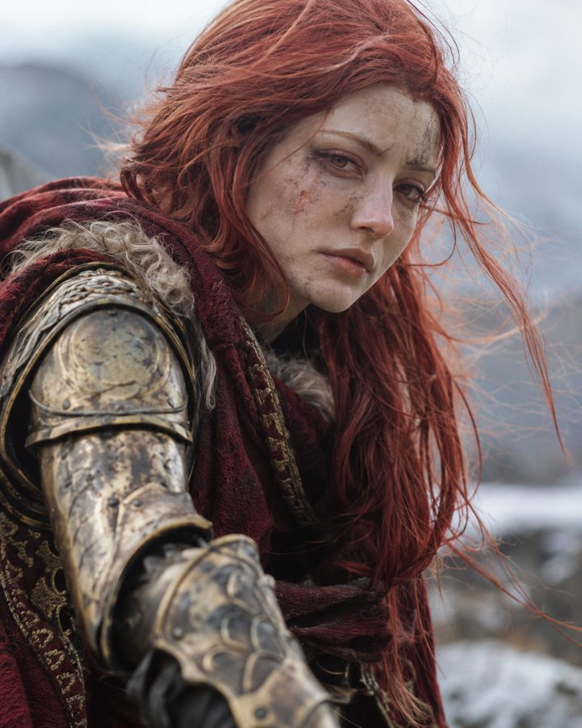

<p align="center">
  
</p>

<p align="center">
  <a href="https://elden-ring-liveaction.xiaosang.cc/">▶ 在线浏览 View Online</a>
  ·
  <a href="https://github.com/holynova/elden-ring-liveaction">GitHub 仓库</a>
</p>

游戏写实影像是一本摄影风格的 AI 画册：把艾尔登法环、赛博朋克 2077、塞尔达传说三部作品的角色与场景，转译为写真质感的图像。共 67 幅，每幅都配有镜头、快门、引言与作品说明，可在画册与灯箱中浏览，也支持键盘翻页。

PHOTO-REAL VIRTUALITY is a photography-style AI gallery reimagining Elden Ring, Cyberpunk 2077 and The Legend of Zelda as realistic photographs. 67 works in total, each with lens and shutter notes, a quote and a caption — browse them in the gallery or lightbox, with keyboard navigation.

## 截图 / Screenshots

<p align="center">
  
  
</p>

## 三个游戏世界 / Three Worlds

| 世界 | 作品 | 看点 |
|------|------|------|
| 艾尔登法环 | 25 幅 | 玛莲妮亚、梅琳娜、黄金树王城；每幅都有 v1 原版与 v2 写实版对照 |
| 赛博朋克 2077 | 21 幅 | 朱迪、强尼·银手、帕南、夜之城天际线 |
| 塞尔达传说：旷野之息 | 21 幅 | 林克、塞尔达、海拉鲁原野行纪 |

## 浏览方式 / How to Browse

- **切换世界**：顶部选择器，或按 `G` 键循环切换三个游戏。
- **看大图**：点击任意图像打开灯箱详情，方向键 `←` `→` 翻页，`Esc` 关闭。
- **对照库**：艾尔登法环的每幅作品都保留了 v1 原版与 v2 写实版，可对照查看转译前后的变化。
- **镜头参数**：每幅作品标注镜头（如 85mm f/1.4）与快门（如 1/500s ISO 100），用于风格描述，不是实际拍摄记录。

## 本地运行 / Run Locally

零构建，静态页面，直接起一个本地服务器：

```bash
python3 -m http.server 8080
# 打开 http://localhost:8080/
```

## 技术 / Tech

- 单页静态站：`index.html` 一个文件承载画册、灯箱与键盘交互，零框架、零构建。
- 作品数据在 `games_data.py`（名称、镜头、快门、引言、说明），由 `generate_full_index.py` 生成页面数据；缩略图由 `generate_thumbnails.py` 维护。

```
index.html              画册单页：三世界切换、灯箱、键盘导航
games_data.py           67 幅作品的数据（名称 / 镜头 / 快门 / 引言 / 说明）
generate_full_index.py  由数据生成页面
generate_thumbnails.py  缩略图维护
originals/              艾尔登法环 v1 原版（25 幅）
v2_20_gallery/          艾尔登法环 v2 写实版（20 幅）
v2_realhuman/           艾尔登法环 v2 写实版（5 幅）
cyberpunk/              赛博朋克 2077（21 幅）
zelda/                  塞尔达传说（21 幅）
```

## English

**PHOTO-REAL VIRTUALITY** is a photography-style AI gallery that reimagines characters and scenes from Elden Ring, Cyberpunk 2077 and The Legend of Zelda: Breath of the Wild as realistic photographs.

- **67 works**: Elden Ring ×25, Cyberpunk 2077 ×21, Zelda ×21. Each work carries lens and shutter notes, a quote and a caption.
- **Browse**: switch worlds from the top selector or press `G`; click any image for the lightbox, flip with `←` `→`, close with `Esc`.
- **v1 / v2 comparison**: every Elden Ring work keeps both its v1 original and its v2 photorealistic version for side-by-side comparison.
- **Run it**: a static single page — `python3 -m http.server 8080`, then open http://localhost:8080/. No build step, no framework.
- **Tech**: one `index.html` holds the gallery, lightbox and keyboard navigation; work data lives in `games_data.py`, thumbnails are maintained by `generate_thumbnails.py`.

## 声明 / Disclaimer

本仓库内容为 AI 生成的非官方二次创作，与 FromSoftware、CD PROJEKT RED、任天堂无关；镜头与相机参数仅用于风格描述。All images are AI-generated unofficial fan works, not affiliated with FromSoftware, CD PROJEKT RED or Nintendo.
